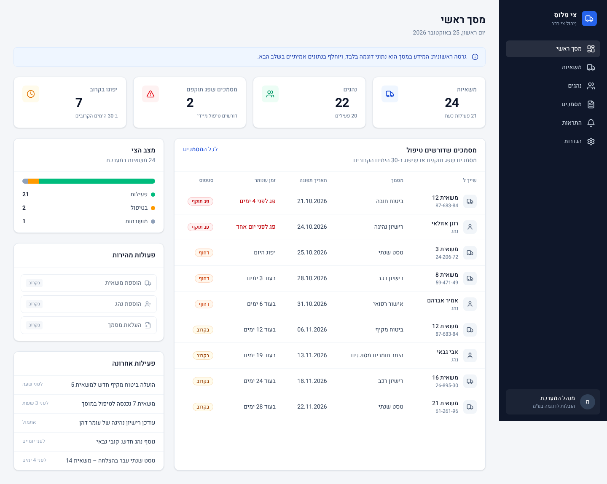

# צי פלוס – מערכת לניהול צי רכב

מערכת לניהול משאיות, נהגים ומסמכים לחברות הובלה (15–50 משאיות).
ממשק בעברית, מימין לשמאל, מותאם למחשב ולטלפון.

> **מצב נוכחי – שלב 1:** שלד המערכת ומסך ראשי עם **נתוני דוגמה בלבד**.
> אין עדיין חיבור למסד נתונים או לשירותים חיצוניים.



## מבנה הפרויקט

```
apps/
  web/              אתר המנהל (Next.js)
    src/app/        המסכים (מסך ראשי, משאיות, נהגים, מסמכים, התראות, הגדרות)
    src/components/ רכיבי תצוגה
    src/lib/        נתוני דוגמה וחישובי המסך הראשי
packages/
  shared/           הגדרות ולוגיקה משותפות לאתר ולאפליקציית הנהגים העתידית
                    (סוגי מסמכים, חישוב תוקף, טקסטים בעברית) + בדיקות
docs/screenshots/   צילומי מסך
```

## טכנולוגיות

- **Next.js 16 + React 19 + TypeScript** – האתר
- **Tailwind CSS 4** – עיצוב, כולל תמיכה מלאה ב-RTL
- **Heebo** – גופן עברי (נטען מתוך הפרויקט, בלי שירות חיצוני)
- **lucide-react** – אייקונים
- **Vitest** – בדיקות אוטומטיות

## הרצה על המחשב

דרישה מוקדמת: התקנת [Node.js](https://nodejs.org) גרסה 20.9 ומעלה (מומלץ LTS).

```bash
npm install      # התקנת הספריות (פעם אחת)
npm run dev      # הפעלת האתר במצב פיתוח
```

לאחר מכן פתחו בדפדפן: http://localhost:3000

### צפייה מהטלפון

1. ודאו שהמחשב והטלפון מחוברים **לאותה רשת Wi‑Fi**.
2. הפעילו במחשב `npm run dev`.
3. בחלון שנפתח יופיעה שורה בשם `Network` עם כתובת כמו `http://192.168.1.23:3000`.
4. הקלידו את הכתובת הזו בדפדפן בטלפון.

## בדיקות

```bash
npm run check    # בדיקת טיפוסים + בדיקת קוד (lint) + בדיקות אוטומטיות
npm run build    # בניית גרסת ייצור
```

## תוכנית העבודה

1. ✅ שלד ומסך ראשי (נתוני דוגמה)
2. מסד נתונים והתחברות משתמשים (Supabase), הרשאות
3. ניהול משאיות ונהגים
4. ניהול מסמכים – העלאה וצילום מהטלפון
5. התראות לפני פקיעת תוקף
6. ליטוש, אבטחה ועלייה לאוויר
7. בעתיד: שאלות בשפה חופשית, אפליקציה לנהגים
